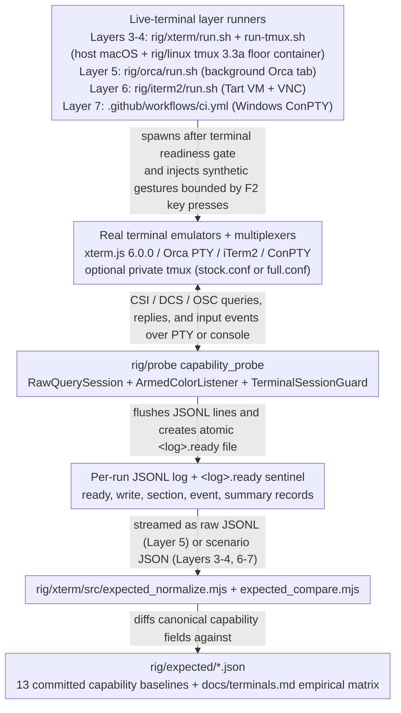
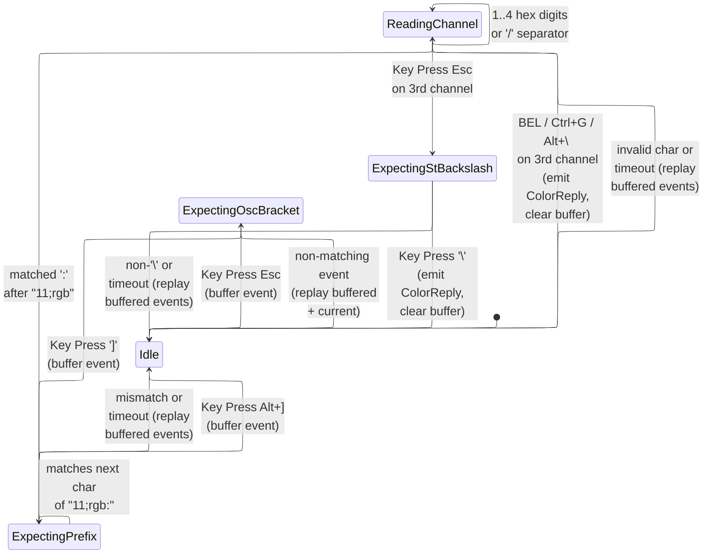
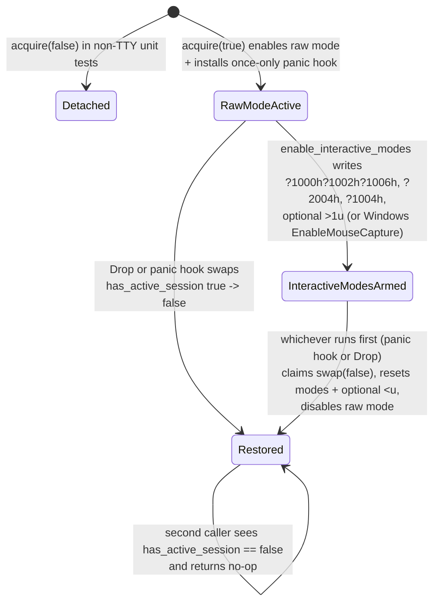
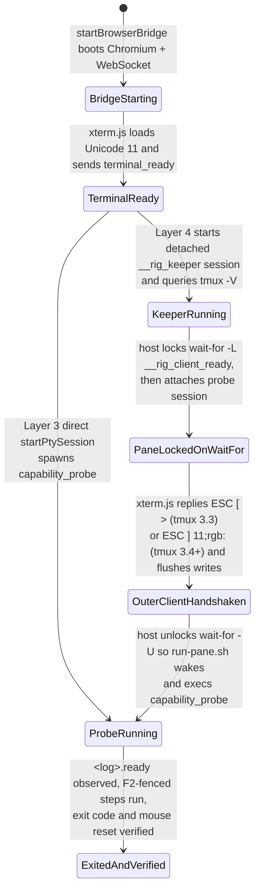

# Headless cross-platform terminal verification rig and measured terminal baselines

<small>

> <table border="0">
> <tr><th colspan="2">Files</th><th colspan="2">Lines</th></tr>
> <tr><td>Changed (total)</td><td>97</td><td>Insertions (+)</td><td>23,474</td></tr>
> <tr><td>Added</td><td>91</td><td>Deletions (-)</td><td>8</td></tr>
> <tr><td>Deleted</td><td>0</td><td>Net change</td><td>+23,466</td></tr>
> </table>

</small>

## 1. Purpose

Before building reusable terminal widgets in `avandar-tui-kit`, engineers had only an empty umbrella crate<sup>G24</sup> and unverified assumptions about how target terminals handle mouse tracking, keyboard protocols, clipboard writes<sup>G16</sup>, background-color queries<sup>G1</sup>, and Unicode glyph widths. Testing terminal behavior against mock buffers misses real emulator quirks, such as `tmux` dropping startup queries before its outer client finishes attaching or Windows ConPTY<sup>G4</sup> delivering pasted text as individual key press and release events instead of a single paste event, whereas automating the developer's active terminal steals window and keyboard focus on every run.

This change:

- Adds a cross-platform probe binary that measures escape-sequence support and input events in live terminals and resets terminal modes on exit or panic (§4).
- Automates mouse, keyboard, paste, and focus tests in headless browser `xterm.js` and isolated `tmux` servers without fixed sleeps (§5).
- Runs automated terminal checks across Orca<sup>G15</sup>, a minimum-version Linux container, a headless `iTerm2` macOS virtual machine, and Windows CI against committed JSON baselines (§6).
- Documents measured terminal behavior across 13 terminal-and-OS combinations, and also adds contributor rules for post-plan code review, committed code walkthroughs, and merge-gate checklists (§7).

## 2. Background technical context

```text
AGENTS.md            (changed)
crates/
└── avandar-tui-kit/
docs/
├── architecture.md  (changed)
├── terminals.md     (changed)
└── testing.md       (changed)
rig/
├── expected/        (new)
├── iterm2/          (new)
├── probe/           (new)
├── tmux/            (new)
└── xterm/           (new)
```

<small>

| Unit | What it is |
| --- | --- |
| `AGENTS.md` | Repository rules for coding agents covering supported platforms, test-first workflow, documentation lifecycle, and required review passes. |
| `crates/avandar-tui-kit` | Published umbrella library crate<sup>G24</sup> for `ratatui` terminal UI building blocks, which will re-export future per-concern crates behind Cargo features. It holds no runtime code yet while Milestone 0<sup>G13</sup> verifies target terminals first. |
| `docs/architecture.md` | Workspace map of the directory layout, shared Cargo settings, and the eight planned building-block crates that `crates/avandar-tui-kit` will re-export. |
| `docs/terminals.md` | Reference matrix of the toolkit's supported terminals (`iTerm2` and `xterm.js`), multiplexer (`tmux`), and platforms (`macOS`, `Linux`, and `Windows`), recording what escape sequences and input events each supports. Every rule on this page is backed by `rig/expected/`. |
| `docs/testing.md` | Defines the repository's seven verification layers<sup>G26</sup> and the five rules every automated terminal test follows, including zero fixed sleeps and starting the child program only after the terminal is listening (`Rule 5`). |
| `rig/expected` | Thirteen committed JSON capability baselines<sup>G3</sup> covering every supported combination of Orca<sup>G15</sup>, browser `xterm.js`, `iTerm2`, and `tmux` across macOS, Linux, and Windows. Runner checks normalize live `capability_probe` logs and diff them against these files. |
| `rig/iterm2` | Headless macOS virtual machine driver that boots a prepared Apple Silicon Tart<sup>G23</sup> guest (`tuikit-macos`), drives real `iTerm2` over loopback VNC, and runs `capability_probe` alone and under `tmux`. |
| `rig/probe` | Unpublished Rust workspace crate whose `capability_probe` example binary (`examples/capability_probe.rs` and `src/probe_runner.rs`) queries live terminal capabilities, logs input events as JSON lines, and restores terminal modes on exit or panic. Every live verification layer<sup>G26</sup> runs this binary inside the terminal under test. |
| `rig/tmux` | Holds `stock.conf` (empty defaults) and `full.conf` (mouse, focus, clipboard, extended keys, and passthrough<sup>G17</sup>), the two isolated `tmux` server configurations loaded by every `tmux` verification runner. |
| `rig/xterm` | Node and Playwright harness that connects browser `@xterm/xterm` to `capability_probe` over a pseudo-terminal directly (`run.sh`) or through a private `tmux` server (`run-tmux.sh`). Also provides `expected_normalize.mjs` and `expected_compare.mjs`, which diff live probe logs against `rig/expected/`. |

</small>

## 3. Shape of the solution

Milestone 0<sup>G13</sup>, the preliminary stage in `docs/milestones.md`, verifies real terminal emulators before any UI crate code lands in `crates/avandar-tui-kit`. Seven verification layers<sup>G26</sup> check the workspace without stealing window or keyboard focus on the developer's machine: Layers 1 and 2 run Rust unit and escape-sequence tests (`just test` on the host and `just linux` inside `rig/linux`, a Debian container pinning the minimum supported Rust `1.88` and `tmux` `3.3a` versions) plus cross-target Windows and Linux `clippy` (`just lint-targets`). Layers 3 through 7 run a shared Rust binary (`capability_probe` in `rig/probe`) inside live terminals: Playwright Chromium with `@xterm/xterm@6.0.0` over `node-pty` (`rig/xterm/run.sh`, Layer 3), private `tmux -L` servers attached to `xterm.js` (`rig/xterm/run-tmux.sh`, Layer 4), unfocused background Orca<sup>G15</sup> terminals (`rig/orca/run.sh`, Layer 5), a cold-booted headless Tart<sup>G23</sup> macOS virtual machine driving `iTerm2` over loopback VNC (`rig/iterm2/run.sh`, Layer 6), and cross-OS GitHub Actions runners including Windows Server ConPTY<sup>G4</sup> (`.github/workflows/ci.yml` and `rig/windows/run.sh`, Layer 7). Inside each terminal, `capability_probe` exchanges escape sequences with its controlling terminal, flushes newline-delimited JSON records (`.jsonl`) for every terminal write, capability section, and input event, and creates a paired `<log>.ready` sentinel file<sup>G19</sup> once startup queries and interactive terminal modes are active so harnesses know when to start sending synthetic input.

The four strands connect in dependency order. Strand 1 (§4) builds `capability_probe` and its session-restoration and query state machines, plus Windows `.cmd` argument quoting. Strand 2 (§5) builds the browser `xterm.js`, `tmux`, and `iTerm2` readiness and key-fence input drivers that execute `capability_probe` deterministically without fixed sleeps. Strand 3 (§6) wraps `capability_probe` and the `xterm.js` normalizer inside the Linux floor container<sup>G9</sup>, Orca<sup>G15</sup>, Tart<sup>G23</sup> virtual machine, and CI runners to compare live runs against 13 committed baselines in `rig/expected/*.json`. Strand 4 (§7) distills the empirical measurements from those 13 baselines into `docs/terminals.md` and updates contributor workflow rules in `AGENTS.md` and `docs/architecture.md`; the workflow rules in §7.2 are independent of the runtime rig code.



> *Every live-terminal layer (Layers 3 through 7) runs the same `capability_probe` binary inside a real terminal emulator and normalizes its JSONL log into the shared schema under `rig/expected/*.json`.*
>
> **Diagram key**
>
> | | |
> | --- | --- |
> | **CSI / DCS / OSC** | Standard terminal escape-sequence families for control queries (`CSI`), device-control strings (`DCS`), and operating-system commands such as colors and clipboard (`OSC`). |
> | **Orca<sup>G15</sup> / Tart<sup>G23</sup> VM** | Embedded `@xterm/xterm` terminal in the Orca<sup>G15</sup> desktop app, and headless macOS virtual machine running `iTerm2` over loopback VNC. |
> | **ConPTY<sup>G4</sup>** | Windows Pseudo Console, the OS layer between console apps and terminal emulators on Windows. |
> | **stock.conf / full.conf** | Empty default `tmux` config versus full mouse, focus, clipboard, extended-key, and passthrough<sup>G17</sup> config in `rig/tmux/`. |
> | **`<log>.ready`** | File written by `capability_probe` after startup queries and mode setup complete, signaling that interactive input can begin. |
> | **RawQuerySession / ArmedColorListener / TerminalSessionGuard** | The three `rig/probe` components for raw query reads, late background-color replies, and mode restoration (§4). |

## 4. `capability_probe` reads terminal replies only while a query is active and restores terminal modes once on exit or panic

Strand 1 builds `capability_probe` in `rig/probe`, whose internal modules also prototype the terminal session and query primitives scheduled to move into the published `avandar-tui-term` library crate in Milestone 3. Because `avandar-tui-kit` crates are libraries called by applications that own their own event loops, no helper in `rig/probe` may leave a permanent background reader thread blocked on `/dev/tty` (or `stdin` fallback) or leave mouse-tracking flags enabled if the caller panics. `rig/probe` splits terminal interaction into three bounded components: `DemandByteReader` for raw byte replies terminated by Primary Device Attributes<sup>G6</sup> (`DA1`) [1], `ColorReplyParser` and `ArmedColorListener` for `OSC 11` background-color replies [2] decoded through `crossterm::event`, and `TerminalSessionGuard` for idempotent mode teardown across normal return and stack unwinding.

### 4.1 `DemandByteReader` bounds capability queries with a Primary Device Attributes reply and parks its `/dev/tty` thread between reads so later key events stay unread

For startup capability checks, `RawQuerySession` (`rig/probe/src/terminal_io/mod.rs`) sends control queries (`XTVERSION` terminal-version requests, `DECRQM` mode-status requests<sup>G8</sup>, Kitty `? u` keyboard-flag queries, `CSI 16 t` cell-pixel-size requests, and `CSI 6 n` cursor-position width checks [1], [2], [3]) that unsupported terminals silently ignore. Waiting on a per-query timeout for every unsupported sequence would stall startup for seconds. Instead, `RawQuerySession::query_fenced` appends `DA1` (`ESC [ c`) to each query batch. Because conformant Unix terminals process input first-in-first-out and answer `DA1` with `ESC [ ? ... c`, reading until the `DA1` reply arrives proves whether earlier queries in the batch were answered without sleeping on unsupported ones.

On Unix, reading raw bytes directly on the main thread would block forever if a broken pseudo-terminal drops `DA1`, whereas spawning an unthrottled background reader thread would immediately call `read()` again after `DA1` and swallow bytes meant for `crossterm::event`. `DemandByteReader::spawn` solves both constraints with a pair of capacity-1 rendezvous channels (`mpsc::sync_channel(1)`).

**File: `rig/probe/src/terminal_io/demand_reader.rs`**

```rust {9-12}
impl DemandByteReader {
    pub fn spawn<R>(mut reader: R) -> Self
    where
        R: Read + Send + 'static,
    {
        ...
        let worker_handle = thread::spawn(move || {
            let mut scratch = [0_u8; 1024];
            while request_receiver.recv().is_ok() {
                let read_result = reader
                    .read(&mut scratch)
                    .map(|byte_count| scratch[..byte_count].to_vec());
                if reply_sender.send(read_result).is_err() {
                    break;
                }
            }
        });
        ...
    }
}
```

`DemandByteReader::read_until_da1` accumulates chunks into a local `collected_bytes` buffer, calling `poll_next_chunk` to send one `()` token on `request_sender` only while `!self.has_pending_read` and `!has_da1_reply(&collected_bytes)`. For example, in `demand_reader.rs`'s scripted-chunk unit test, when a stream holds an `XTVERSION` reply (`\x1bP>|xterm.js(6.0.0)\x1b\\`), a `DA1` reply (`\x1b[?62;22c`), and a third chunk belonging to a subsequent `OSC 11` reply or user keystroke (`\x1b]11;rgb:1a/1b/26\x07`), `read_until_da1` issues two request tokens, matches `has_da1_reply` after chunk 2, and returns while the worker parks on `request_receiver.recv()` without reading chunk 3. Dropping `DemandByteReader` then drops `request_sender` and joins `worker_handle` synchronously so `/dev/tty` closes before `crossterm::event` opens it. If a non-conforming pseudo-terminal never answers `DA1` within `DA1_FENCE_TIMEOUT_MS` (`2,000` ms), `has_pending_read` remains `true`, `Drop` detaches the blocked worker instead of hanging exit, and `RawQuerySession::has_fence_timed_out` short-circuits all remaining raw queries. On Windows (`#[cfg(windows)]`), `RawQuerySession::open` sets `reader: None` because ConPTY<sup>G4</sup> drops raw `CSI` and `DCS` replies before they reach the console input stream, while `#[cfg(windows)] measure_sample_width` still measures all 33 glyph widths by comparing `crossterm::cursor::position()` before and after printing each sample.

### 4.2 `ColorReplyParser` and `ArmedColorListener` decode late background-color replies from `crossterm` key events without dropping user `Esc` keystrokes

Once `RawQuerySession::into_writer` drops `DemandByteReader` and closes `/dev/tty`, `capability_probe` sends the `OSC 11` background-color query<sup>G1</sup> (`\x1b]11;?\x07`) and reads the reply through `crossterm::event`, because an outer terminal's forwarded `OSC 11` reply (for example, through `tmux` 3.8 or while an `iTerm2` `tmux -CC` control client attaches) can arrive after interactive key polling has started, while Windows ConPTY<sup>G4</sup> and `tmux` 3.3a leave `OSC 11` unanswered. Once `crossterm::event` is active, an `OSC 11` reply (`ESC ] 11 ; rgb : RRRR / GGGG / BBBB BEL` or `ESC \`) arrives as a sequence of `Event::Key` presses (beginning either with `Esc` then `]` or with `Alt+]` when `crossterm` coalesces `ESC ]`).

`ColorReplyParser` in `rig/probe/src/color_reply/mod.rs` parses that event stream without losing legitimate user `Esc` or `Alt+]` keystrokes. Every candidate `Event` is pushed onto `buffered_events` as the state machine advances; if any subsequent event fails to match the expected `OSC 11` grammar, `reject_with` resets the parser to `Idle` and returns every buffered event plus the failing event in exact arrival order. Feeding `Key(Esc)` transitions `Idle -> ExpectingOscBracket` with `[Key(Esc)]` buffered, so a user pressing `x` next triggers `reject_with`, resets to `Idle`, and replays `[Key(Esc), Key('x')]` in order; whereas `Esc`, `]`, `11;rgb:1a/1b/26`, `Ctrl+G` emits `ColorReply { r: 26, g: 27, b: 38, is_dark: true }` and clears the buffer. When a valid `BEL` (`Ctrl+G` / `\x07`) or `ST` (`Esc` followed by `\`, or `Alt+\` when `crossterm` coalesces `ESC \`) terminates three slash-separated 1-to-4-digit hex channels, `ColorReplyParser` scales each channel to `0..=255` and computes WCAG 2.2 relative luminance<sup>G20</sup> (`0.2126 * R_lin + 0.7152 * G_lin + 0.0722 * B_lin < 0.179` -> `is_dark = true`) [4].



> *`ColorReplyParser` buffers candidate key events until `BEL` or `ESC \` completes the third hex channel, and replays every buffered event in arrival order if any token diverges or the 2-second armed window expires.*
>
> **Diagram key**
>
> | | |
> | --- | --- |
> | **Idle / ExpectingOscBracket / ExpectingPrefix / ReadingChannel** | `ColorReplyParser` states waiting for `Esc`, `]`, `11;rgb:`, and the three hex RGB channels. |
> | **ExpectingStBackslash** | State after `Esc` on the third RGB channel, waiting for `\` to complete the `ESC \` String Terminator. |
> | **BEL** | ASCII Bell (`0x07`, delivered by `crossterm` as `Ctrl+G`), an alternative `OSC 11` terminator. |
> | **ColorReply** | Parsed 8-bit RGB triple, WCAG relative luminance<sup>G20</sup>, and `is_dark` boolean emitted on completion. |

`capability_probe` runs either in `--batch` mode (executes startup query sections and exits immediately) or in default interactive mode (enables mouse, paste, and focus reporting<sup>G10</sup>, creates `<log>.ready`, and logs live events until `Ctrl+C` or `F12`). In `rig/probe/src/armed_color.rs`, `run_background_color_section` first polls `crossterm::event` for `INITIAL_COLOR_WAIT_MS` (`200` ms). If no reply arrives within 200 ms, `--batch` mode continues polling up to `ARMED_COLOR_WINDOW_MS` (`2,000` ms) and records `"phase": "late"` or `"phase": "timeout"`. Interactive mode instead writes `"phase": "armed_pending"` immediately so `<log>.ready` is not delayed by 2 seconds on terminals that never answer `OSC 11` (such as `tmux` 3.3a and Windows ConPTY<sup>G4</sup>), and hands an armed `ArmedColorListener` to `probe_runner.rs`. If a reply completes before the 2-second deadline, `probe_runner.rs` swallows the synthetic keystrokes and logs a `"section": "background_color_late"` record; if the deadline passes mid-prefix, `expire_if_due` flushes `buffered_events` into the normal event log.

### 4.3 `TerminalSessionGuard` shares one atomic active flag between `Drop` and the panic hook so terminal modes reset once before panic output

Interactive probing enables raw mode<sup>G18</sup>, mouse tracking, bracketed paste<sup>G2</sup> (`?2004h`), focus reporting<sup>G10</sup> (`?1004h`), and optionally Kitty keyboard<sup>G12</sup> disambiguation (`CSI > 1 u`, pushed onto the terminal's mode stack) [2], [3]. Two hazards arise across mode setup and teardown:

1. Calling `crossterm::event::EnableMouseCapture` on Unix writes `?1003h` (any-event motion tracking), which floods pseudo-terminals with SGR<sup>G21</sup> frames whenever the pointer moves across a pane with no button held. `TerminalSessionGuard::enable_interactive_mouse` instead writes `MOUSE_SETUP_M1` (`\x1b[?1000h\x1b[?1002h\x1b[?1006h`: button-press, button-drag, and SGR extended-coordinate mouse reporting) directly on Unix, while using `EnableMouseCapture` (`ENABLE_MOUSE_INPUT`) on Windows where ConPTY<sup>G4</sup> requires console flags to request mouse input from the host terminal.
2. When a thread panics (which `capability_probe` triggers intentionally when interactive mode receives `F12` so harnesses can verify crash recovery), Rust runs the global panic hook *before* unwinding the stack and dropping local guards. If only `Drop` restored terminal modes, the panic message would print with raw mode<sup>G18</sup> still enabled (stair-stepping newlines); if both the panic hook and `Drop` emitted teardown sequences unconditionally, `KITTY_KEYBOARD_POP` (`\x1b[<u`) would execute twice and pop a Kitty mode<sup>G12</sup> frame pushed by an outer application before `capability_probe` ran.



> *`SharedSessionState::has_active_session` guarantees that whichever teardown path runs first (the panic hook before stack unwinding or `TerminalSessionGuard::drop` on normal exit) writes reset bytes and pops Kitty keyboard<sup>G12</sup> mode at most once.*
>
> **Diagram key**
>
> | | |
> | --- | --- |
> | **Detached** | Guard backed by a private `SharedSessionState` with `has_active_session = false`, leaving global `PANIC_HOOK_STATE` untouched. |
> | **RawModeActive** | Terminal raw mode<sup>G18</sup> enabled and `has_active_session = true` stored in `PANIC_HOOK_STATE`. |
> | **InteractiveModesArmed** | Mouse, paste, focus, and optional Kitty `>1u` (`is_kitty_pushed = true`) modes active on the terminal. |
> | **Restored** | Terminal modes reset and raw mode<sup>G18</sup> disabled; any later `Drop` after a panic is a no-op. |
> | **`?1000h?1002h?1006h` / `?2004h` / `?1004h` / `>1u`, `<u`** | Private escape sequences for button/drag/SGR<sup>G21</sup> mouse tracking, bracketed paste<sup>G2</sup>, focus reporting<sup>G10</sup>, and Kitty keyboard<sup>G12</sup> push/pop. |

**File: `rig/probe/src/session_guard.rs`**

```rust {3-6}
impl SharedSessionState {
    fn restore_best_effort(&self) {
        if !self.has_active_session.swap(false, Ordering::AcqRel) {
            return;
        }
        let was_kitty_pushed = self.is_kitty_pushed.swap(false, Ordering::AcqRel);
        let was_raw_mode_enabled = self.is_raw_mode_enabled.swap(false, Ordering::AcqRel);
        let reset_bytes = build_teardown_bytes(was_kitty_pushed);
        self.write_teardown_sequences(&reset_bytes);
        if was_raw_mode_enabled {
            let _ = crossterm::terminal::disable_raw_mode();
        }
    }
    ...
}
```

`PANIC_HOOK_STATE` installs a single process-wide panic hook via `OnceLock<Arc<SharedSessionState>>`. Both that hook and `TerminalSessionGuard::drop` call `restore_best_effort`, where the highlighted `has_active_session.swap(false, Ordering::AcqRel)` ensures only the first caller writes `MOUSE_TEARDOWN_M5` (disabling X10 `?9l`, button `?1000l`, drag `?1002l`, any-motion `?1003l`, UTF-8 `?1005l`, SGR<sup>G21</sup> `?1006l`, urxvt `?1015l`, and SGR-pixel `?1016l` mouse modes, plus `crossterm::event::DisableMouseCapture` on Windows), bracketed paste<sup>G2</sup> (`?2004l`), focus reporting<sup>G10</sup> (`?1004l`), and synchronized output<sup>G22</sup> (`?2026l`) resets, plus the conditional `<u` Kitty pop. When `TerminalSessionGuard::acquire(false)` runs in detached unit tests (`!is_tty_available`), it allocates a private `SharedSessionState` instance so parallel Rust unit tests never touch `PANIC_HOOK_STATE` or race on global flags.

### 4.4 `quote_cmd_arg` quotes arguments for Windows `.cmd` wrapper scripts across two `cmd.exe` passes and `CommandLineToArgvW`

Independent of escape-sequence probing, `rig/probe/src/cmd_shim.rs` prototypes Windows `.cmd` argument quoting for future agent-spawning crates and verifies it against live `cmd.exe` on Windows CI (`windows-2025`). Windows tools distributed via `npm` or `orca` frequently expose `.cmd` wrapper scripts forwarding `%*` to a native `.exe`. Executing a `.cmd` shim through `cmd.exe /D /S /C "<invocation>"` parses the command line three times: `cmd.exe` pass 1 on the outer `/S /C` string, `cmd.exe` pass 2 when the batch file expands `%*`, and `CommandLineToArgvW` (UCRT) inside the target `.exe`.

**File: `rig/probe/src/cmd_shim.rs`**

```rust {3,9,11,16,21-22}
pub fn quote_cmd_arg(argument: &str) -> String {
    ...
    quoted.push('"');
    let mut pending_backslashes = 0_usize;
    for character in argument.chars() {
        match character {
            ...
            '"' => {
                quoted.extend(std::iter::repeat_n('\\', pending_backslashes * 2));
                pending_backslashes = 0;
                quoted.push_str("\"\\^^^\"\"");
            }
            '%' => {
                quoted.extend(std::iter::repeat_n('\\', pending_backslashes));
                pending_backslashes = 0;
                quoted.push_str("%%cd:~,%");
            }
            ...
        }
    }
    quoted.extend(std::iter::repeat_n('\\', pending_backslashes * 2));
    quoted.push('"');
    quoted
}
```

A naive `\"` breaks `cmd.exe`'s quote state on pass 1 and exposes `&`, `|`, `<`, `>`, `(`, `)`, or `%PATH%` to shell execution or expansion. `quote_cmd_arg` wraps the argument in outer double quotes and encodes each embedded `"` by closing the active quote, emitting `\^^^"`, and reopening the quote. For input `a"b` inside `cmd.exe /D /S /C "\"<shim>\" \"a\"\^^^\"\"b\""`: `cmd.exe` pass 1 strips the outer `/S /C` quotes and collapses unquoted `^^^"` to `^"`, leaving `"a"\^""b"`; `cmd.exe` pass 2 (`.cmd` `%*` expansion) collapses unquoted `^"` to `"`, leaving `"a"\""b"`; and `CommandLineToArgvW` parses quoted `a`, backslash-escaped literal `"`, and quoted `b` into `a"b` without ever exposing user text outside quotes during either `cmd.exe` pass. For `%`, pass 1 expands the zero-length substring slice `%cd:~,%` to empty text after the leading `%`, leaving a literal `%` that pass 2 does not re-expand when substituting `%*`. Backslashes are doubled only before `"` or the closing quote (`pending_backslashes * 2`) because `CommandLineToArgvW` treats backslashes before non-quote characters literally, while embedded `\0`, `\r`, and `\n` cannot cross `cmd.exe` without truncating the command line and are stripped.

## 5. Browser `xterm.js`, `tmux`, and `iTerm2` harnesses synchronize startup and synthetic input on terminal replies instead of fixed sleeps

Layers 3 and 4 (`rig/xterm/`, natively on macOS and Windows and inside the `rig/linux` floor container<sup>G9</sup>) run `capability_probe` inside a real `@xterm/xterm@6.0.0` instance hosted in headless Playwright Chromium over `node-pty`, either directly (`run.sh`) or through an isolated `tmux -L <socket>` server (`run-tmux.sh`). Layer 6 (`rig/iterm2/`) applies the same readiness and fence discipline to native `iTerm2` over VNC. Every synchronization boundary uses explicit state or first-in-first-out terminal replies; a test in `rig/probe/tests/m0_docs_invariants.rs` scans non-binary production files across `rig/` (excluding `rig/expected/` and test suites) to enforce zero standalone `sleep` calls.

### 5.1 `createTmuxSession` holds the `tmux` pane on a `wait-for` mutex lock until `tmux` finishes querying the attached `xterm.js` client

Spawning `tmux new-session capability_probe` directly inside `node-pty` and attaching `xterm.js` to the pseudo-terminal loses startup queries in two separate places:

1. If `node-pty` spawns a child before Chromium finishes loading `xterm.js`, opening its WebSocket, and measuring its grid, early output bytes fire before `terminal.onData` is wired (`Rule 5` in `docs/testing.md`).
2. Even when `xterm.js` is already listening (`bridge.isTerminalReady === true`), `tmux new-session <cmd>` forks the pane process *in parallel* with querying the outer client terminal (`xterm.js`) for its capabilities (`DA1`, `DA2`, `XTVERSION`, `OSC 11`). Any `XTVERSION`, `OSC 11`, or `OSC 52` passthrough<sup>G17</sup> sequence that `capability_probe` emits during those first milliseconds arrives at the `tmux` server before `tmux` finishes registering the attached client, so `tmux` silently drops it.

`startBrowserBridge` (`rig/xterm/src/bridge_server.mjs`), `startPtySession` (`rig/xterm/src/pty_session.mjs`), and `createTmuxSession` (`rig/xterm/src/tmux_session.mjs`) drive every Layer 3 and Layer 4 session through an explicit readiness state machine before `capability_probe` executes.



> *Layer 3 spawns `capability_probe` directly from `TerminalReady`, whereas Layer 4 holds `run-pane.sh` on the `__rig_client_ready` mutex until `tmux` finishes its outer capability handshake with `xterm.js`.*
>
> **Diagram key**
>
> | | |
> | --- | --- |
> | **BridgeStarting / TerminalReady** | Browser bridge states before and after `web/index.html` opens `xterm.js` and reports non-zero cell geometry. |
> | **KeeperRunning** | Detached `__rig_keeper` session keeping the private `tmux -L` server alive before any client attaches. |
> | **PaneLockedOnWaitFor / OuterClientHandshaken** | `tmux` attach states while `run-pane.sh` blocks on the `wait-for -L` mutex until `xterm.js` answers `tmux`'s attach queries (`ESC [ >` `DA2` or `ESC ] 11;rgb:` `OSC 11`). |
> | **ProbeRunning / ExitedAndVerified** | Active `capability_probe` execution (creating `<log>.ready` and handling `F2`-fenced gestures) followed by teardown verification. |
> | **`wait-for -L` / `-U`, `F2`-fenced** | `tmux` server mutex lock/unlock commands, and synthetic gestures each bounded by a trailing `F2` key press. |

#### Step 1. `startBrowserBridge` (`rig/xterm/src/bridge_server.mjs`)

`startBrowserBridge` starts a loopback HTTP and WebSocket server (`127.0.0.1:0`), launches headless Chromium onto `rig/xterm/web/index.html`, loads `@xterm/xterm@6.0.0` and `@xterm/addon-unicode11` (`terminal.unicode.activeVersion = '11'`), waits for non-zero CSS cell dimensions via `requestAnimationFrame`, and resolves only when `terminal_ready` arrives over the WebSocket. Without this step, `startPtySession` and `createTmuxSession` throw `Rule 5 violation: cannot spawn child process before browser terminal is listening`.

#### Step 2. `startDetachedKeeperSession` (`rig/xterm/src/tmux_session.mjs`)

`startDetachedKeeperSession` spawns `tmux -L <socket> -f rig/tmux/<stock|full>.conf new-session -d -s __rig_keeper -x <cols> -y <rows> cat` under `buildSanitizedPtyEnv` (which strips 18 outer-terminal variables including `TMUX`, `TERM_PROGRAM`, `ORCA_VERSION`, and `WT_SESSION` and sets `TERM=xterm-256color`), then runs `queryTmuxServerInfo` (`tmux -V` and `show-options -g mouse`). Without `__rig_keeper`, the private `tmux` server would not exist yet to accept `wait-for -L` in step 3, and the harness would not know the server version needed to pick the handshake token in step 4.

#### Step 3. `tmux -L <socket> wait-for -L __rig_client_ready`

`attachGatedTmuxClient` acquires the exclusive server-side `tmux` mutex lock `__rig_client_ready` (`wait-for -L`) on the private server *before* starting the `probe` session. Without acquiring that mutex first on the host, `run-pane.sh` inside step 4 would acquire and unlock `__rig_client_ready` immediately and launch `capability_probe` before `xterm.js` finishes attaching.

**File: `rig/xterm/src/tmux_session.mjs`**

```javascript {4-7,13-14}
async function attachGatedTmuxClient({
  options, socketName, paneCommand, tmuxServerInfo, sanitizedEnv, cols, rows, timeoutMs,
}) {
  spawnSync('tmux', ['-L', socketName, 'wait-for', '-L', '__rig_client_ready'], {
    env: sanitizedEnv,
    stdio: 'ignore',
  });
  const ptySession = startPtySession({
    command: 'tmux',
    args: ['-L', socketName, 'new-session', '-s', 'probe', paneCommand],
    ...
  });
  const expectedPrefix = isTmux33Version(tmuxServerInfo.version) ? '\x1b[>' : '\x1b]11;rgb:';
  const handshakeWaiter = createHandshakeReplyWaiter(options.bridge, expectedPrefix, timeoutMs);
  ...
}
```

#### Step 4. `startPtySession` with `run-pane.sh` (`rig/xterm/src/tmux_session.mjs`)

`attachGatedTmuxClient` calls `startPtySession` to spawn `tmux -L <socket> new-session -s probe '/bin/sh run-pane.sh ...'` inside `node-pty` wired to `bridge` (`run-pane.sh` is generated into the session scratch directory by `writePaneWrapperScript`). Inside the new pane, `run-pane.sh` immediately runs `tmux -L "$tmux_socket" wait-for -L __rig_client_ready` and blocks because step 3 already holds the mutex. Meanwhile, attaching the `probe` client causes `tmux` to emit its outer-terminal capability queries through `node-pty` into `xterm.js`. `run-pane.sh` also captures `capability_probe`'s exit status to `pane.exit.tmp` and renames it to `pane.exit` before exiting, because `tmux` itself returns client exit code `0` even when a pane process panics with exit code `101`.

#### Step 5. `completeTmuxClientHandshake` (`rig/xterm/src/tmux_session.mjs`)

`completeTmuxClientHandshake` watches `bridge.onTerminalInput` for `xterm.js`'s reply to the final query in `tmux`'s client-attach burst (`tmux` 3.4 added an `OSC 11` background-color query<sup>G1</sup> after `DA2` `CSI > c`), calls `bridge.flushTerminalWrites` (waiting until `web/index.html` acknowledges the latest `sequenceNumber` via `write_ack`), and runs `tmux -L <socket> wait-for -U __rig_client_ready`. Releasing the mutex transfers lock ownership to `run-pane.sh`'s blocked `wait-for -L`, waking `run-pane.sh`, which immediately releases `__rig_client_ready` with `wait-for -U` and executes `capability_probe`.

| `tmux` server version | Final attach query answered by `xterm.js` | `expectedPrefix` matched on `bridge.onTerminalInput` |
| --- | --- | --- |
| `tmux 3.3` / `tmux 3.3a` (`rig/linux` floor container<sup>G9</sup>) | Secondary Device Attributes<sup>G7</sup> (`CSI > c`) | `\x1b[>` (e.g., `\x1b[>0;276;0c`) |
| `tmux 3.4+` (`tmux 3.8` on macOS) | Background color query (`OSC 11`) | `\x1b]11;rgb:` (e.g., `\x1b]11;rgb:1212/2727/3838\x1b\\`) |

Layer 6 (`PTY_RUNNER_SCRIPT` in `rig/iterm2/driver/guest_scripts.py`, written into the shared session directory as `_pty_runner.py`) enforces the analogous guarantee for `iTerm2`'s `tmux -CC` control mode<sup>G5</sup>: when `wait_cc_attach` is `true`, `_pty_runner.py` opens `/dev/tty` in raw mode<sup>G18</sup> and repeatedly sends `OSC 11 ; ?` + `DA1` (`\x1b]11;?\x07\x1b[c`) up to a 5.0-second deadline until a reply containing `rgb:` and not `rgb:0000/0000/0000` arrives, flushes `/dev/tty`, restores terminal attributes, and invokes `capability_probe` via `subprocess.run`.

### 5.2 `bridge_server.mjs` streams PTY output to `xterm.js` as Base64 `Uint8Array` bytes so multi-byte UTF-8 glyphs split across reads are not replaced with `U+FFFD`

Both Layer 3 (`run.sh`) and Layer 4 (`run-tmux.sh`) transport pseudo-terminal output from Node into Chromium through `rig/xterm/src/bridge_server.mjs` and `rig/xterm/web/index.html`. Rather than converting `ptyProcess.onData` buffers to UTF-8 strings in Node, `bridge_server.mjs` Base64-encodes raw byte chunks (`chunkToBase64`), and `web/index.html` decodes them back into a `Uint8Array` (`makeUint8ArrayFromBase64`) passed directly to `terminal.write(outputBytes, callback)`. When `capability_probe` prints 33 multi-byte UTF-8 width samples (including 4-byte emoji and 18-byte `family_zwj`), OS pseudo-terminal reads can split a 4-byte UTF-8 scalar across two `onData` chunks. Decoding each chunk independently with `.toString('utf8')` would replace both halves with `U+FFFD` (`width 1` each instead of `width 2`), corrupting width measurements; passing `Uint8Array` lets `xterm.js`'s streaming byte parser reassemble split code points across writes. In the reverse direction, `terminal.onBinary` forwards non-UTF-8 mouse encodings as `latin1` buffers alongside `terminal.onData`.

### 5.3 Interactive harnesses map cell coordinates to viewport or Retina VNC pixels and send an `F2` key press after each synthetic gesture to bound its logged events

Once `<log>.ready` appears, interactive scenarios drive 11 pointer gestures in `rig/xterm/src/interactive_scenario.mjs` (`hover`, `left_click`, `left_drag`, `wheel_down`, `wheel_up`, `right_click`, `shift_click`, `alt_click`, `alt_drag`, `ctrl_click`, `double_click`) and 12 in `rig/iterm2/driver/interactive_steps.py` (adding `cmd_click` in `iTerm2`), 7 keyboard chords, bracketed paste<sup>G2</sup>, focus loss/gain, and a second `capability_probe` run passing `--push-kitty` to test `alt_enter`, `shift_enter`, and `ctrl_enter` with Kitty keyboard<sup>G12</sup> disambiguation active.

In browser `xterm.js`, `cellCenterToViewportPx` (`rig/xterm/src/cell_coords.mjs`) maps 0-based `(column, row)` indices to `screenLeftPx + (column + 0.5) * cellWidthPx` and `screenTopPx + (row + 0.5) * cellHeightPx`. Inside the macOS Tart<sup>G23</sup> VM (`rig/iterm2/`), VNC pointer coordinates operate in 2x Retina framebuffer pixels while CoreGraphics (`kCGWindowBounds`) reports window bounds in logical points, `iTerm2` bottom-aligns its character grid with a 5-point left margin and 1-point bottom padding, non-`-CC` `tmux` adds 1 status-bar row below `capability_probe`'s pane, and `tmux` forwards `CSI 16 t` cell dimensions in physical Retina pixels (`14x34`) whereas direct `iTerm2` reports logical points (`7x17`).

```text
+(window_x_pt, window_y_pt)--------------------- window_width_pt ---------------------+
|                     top slack = window_height_pt - rows * cell_height_pt - 1.0 pt   |
|<-5pt->+---------------------------------------------------------------------------+ |
|       | (0, 0) capability_probe pane (100 cols x 30 rows)                         | |
|       |        target cell (column, row) center -> * backing_scale (2.0) -> VNC   | |
|       +---------------------------------------------------------------------------+ |
|       | [0] tmux status bar (1 extra row when tmux_mode is "stock" or "full")     | |
|       +---------------------------------------------------------------------------+ |
|                                    1.0 pt bottom padding                            |
+-------------------------------------------------------------------------------------+
Key: kCGWindowBounds logical-point layout mapped by cell_center_to_vnc_pixels
     (rows = 30 direct, 31 in tmux).
```

**File: `rig/iterm2/driver/vnc_input.py`**

```python {3-6,10-11}
def cell_center_to_vnc_pixels(geometry: WindowGeometry, column: int, row: int) -> tuple[int, int]:
    """Maps 0-indexed `(column, row)` cell coordinates to Retina VNC framebuffer pixel coordinates."""
    origin_x_pt = geometry.window_x_pt + 5.0
    origin_y_pt = geometry.window_y_pt + (
        geometry.window_height_pt - (geometry.rows * geometry.cell_height_pt) - 1.0
    )
    center_x_pt = origin_x_pt + (column + 0.5) * geometry.cell_width_pt
    center_y_pt = origin_y_pt + (row + 0.5) * geometry.cell_height_pt
    return (
        int(round(center_x_pt * geometry.backing_scale)),
        int(round(center_y_pt * geometry.backing_scale)),
    )
```

Before calling `cell_center_to_vnc_pixels`, `resolve_session_geometry` (`rig/iterm2/driver/iterm_window.py`) adds `1` to `outer_rows` when `tmux_mode` is `"stock"` or `"full"` and passes `CSI 16 t` cell dimensions through `normalize_cell_size_pt`, which divides `(raw_width, raw_height)` by `backing_scale` (`2.0`) whenever `columns * raw_width > window_width_pt` or `rows * raw_height > window_height_pt`. For a `100x30` `capability_probe` pane inside `tmux` plus `1` status-bar row (`geometry.rows = 31`) in an `iTerm2` window at `(X=80, Y=62, Width=710, Height=556)` where `CSI 16 t` reports `14x34`, `normalize_cell_size_pt` normalizes the cell to `(7.0, 17.0)` points; clicking cell `(10, 5)` computes `origin_x_pt = 85.0`, `origin_y_pt = 62 + (556 - 31*17 - 1) = 90.0`, `center = (158.5, 183.5)` points, and VNC framebuffer pixel `(317, 367)`, landing on `capability_probe` cell `(10, 5)`.

To know when a gesture's events (or deliberate *absence* of events, such as `hover` under mode `1002` or `Option+click` intercepted by `iTerm2`) have finished traversing the emulator, pseudo-terminal, and `crossterm`, `runFencedStep` sends an `F2` key fence<sup>G11</sup> right after each gesture and calls `waitForFenceSlice`.

**File: `rig/xterm/src/interactive_scenario.mjs`**

```javascript {6-11}
function waitForFenceSlice(stepContext, startRecordCount, stepLabel) {
  return waitForLogRecords(
    stepContext.logPath,
    (records) => {
      const trailingRecords = records.slice(startRecordCount);
      const fenceOffset = trailingRecords.findIndex(isFencePressRecord);
      return fenceOffset === -1
        ? null
        : trailingRecords
            .slice(0, fenceOffset)
            .filter((record) => record.kind === 'event' && !isFenceKeyRecord(record));
    },
    ...
  );
}
```

Because both Playwright/VNC input injection and the pseudo-terminal byte stream are first-in-first-out, every event emitted by the gesture is logged into `<logPath>` at an index `>= startRecordCount` and `< startRecordCount + fenceOffset`. When testing `focusLostEvents` (`terminal.blur()`), calling `page.keyboard.press('F2')` would refocus the browser element or fail to reach `xterm.js`; `sendFenceKey` handles `shouldPreserveBlur = true` by dispatching a synthetic `keydown` (`keyCode: 113`) directly onto `xterm.js`'s hidden input element (`.xterm-helper-textarea`), flushing the `ESC [ O` focus-out sequence through `xterm.js` while leaving the terminal blurred for the subsequent `focusGained` check. Similarly, in Layer 6 (`rig/iterm2/driver/iterm_window.py`), right-clicking or `Ctrl`-clicking `iTerm2` opens a macOS context menu (`kCGWindowLayer > 0`) that captures keyboard input; `dismiss_popup_menus_if_any` detects the popup layer via CoreGraphics, presses `Esc`, and polls until the popup closes before sending the `F2` fence key<sup>G11</sup>.

## 6. Platform runners isolate the developer's desktop and shell environment and compare normalized probe logs against committed JSON baselines

The Linux floor container<sup>G9</sup> (`rig/linux`), Layer 5 (`rig/orca`), Layer 6 (`rig/iterm2`), and Layer 7 (`.github/workflows/ci.yml` and `rig/windows`) wrap `capability_probe` and the `rig/xterm` normalizer so every target environment can be verified locally via `just` recipes (`just check`, `just lint-targets`, `just xterm`, `just xterm-tmux`, `just linux`, `just orca`, `just iterm2`, `just windows`) and in CI without polluting host settings.

### 6.1 Container, background-tab, virtual-machine, and CI runners isolate host focus, environment variables, and desktop preferences

Running live terminal harnesses on a developer machine or CI runner risks stealing window focus, leaking outer shell variables such as `TMUX` or `TERM_PROGRAM`, or altering user desktop preferences, so each runner isolates its own environment:

- **`rig/linux/run.sh` runs Linux checks inside a Debian Bookworm container (Rust `1.88` and `tmux` `3.3a`) with isolated Docker build volumes.** `rig/linux/run.sh` hashes `rig/linux/Dockerfile`, `rig/linux/entrypoint.sh`, `rig/xterm/package.json`, and `rig/xterm/package-lock.json` (`avandar-tui-kit-linux:<12-hex-sha>`), builds the `rust:1.88-bookworm` floor image<sup>G9</sup> once on cache miss, mounts the repository read-write alongside three named per-architecture Docker volumes (`tuikit-linux-cargo-home-<arch>`, `tuikit-linux-cargo-target-<arch>`, and `tuikit-linux-xterm-modules-<arch>`) so container Linux binaries never clobber macOS host `target/` or `node_modules/` builds, and forwards `RIG_XTERM_LOG_DIR` into the container.
- **`rig/orca/run.sh` runs `capability_probe` in an unfocused background Orca<sup>G15</sup> terminal tab and closes the tab on exit.** `rig/orca/run.sh` resolves the `orca` CLI binary (skipping `/usr/bin/orca` on Linux, which belongs to the GNOME screen reader), launches `capability_probe` via `orca terminal create` without focusing the tab, waits via `orca terminal wait --for exit`, and closes the tab via `orca terminal close --tab` in an `EXIT` trap. Passing `--tmux stock` or `--tmux full` wraps the command in an isolated `TMUX= tmux -L <socket>` server inside the Orca pane.
- **`rig/iterm2/run.sh` drives `iTerm2` inside a headless macOS virtual machine over loopback VNC and restores guest preferences after every run.** `rig/iterm2/driver/main.py` cold-boots the prepared `tuikit-macos` Tart<sup>G23</sup> virtual machine (`DEFAULT_VM_NAME` in `rig/iterm2/driver/__init__.py`) with `--no-graphics --no-audio --no-clipboard --vnc-experimental` (binding Apple's Virtualization.framework VNC server to `127.0.0.1:<port>` with zero host GUI window), mounts a host staging directory via VirtioFS<sup>G27</sup> at `/Volumes/My Shared Files/tuikit`, backs up the guest's `com.googlecode.iterm2.plist`, `com.apple.swipescrolldirection`, and macOS Sequoia's `EnableStandardClickToShowDesktop` (disabling wallpaper-click-to-show-desktop during tests so outside-window focus clicks do not hide `iTerm2`), and restores all guest defaults through an idempotent `_restore_defaults_once` closure in `finally` before stopping `tuikit-macos` and waiting for `disk.img`'s file lock to release. On any scenario error, `run_with_failure_screenshot` (`rig/iterm2/driver/scenarios.py`) captures `failure-screenshot.png` over VNC and attaches its path to `DriverError.recovery_hint`.
- **GitHub Actions (`.github/workflows/ci.yml`) and `rig/windows/run.sh` verify Linux, macOS, and Windows Server ConPTY<sup>G4</sup> baselines in CI.** `.github/workflows/ci.yml` runs `clippy`, unit/doc tests, and Rust `1.88` builds across `ubuntu-latest` (inside `rig/linux`), `macos-latest`, and `windows-latest`, runs `cargo fmt --all --check` and workspace Cargo feature-combination checks (`scripts/ci/check-features.sh`) inside the `ubuntu-latest` floor job, and executes seven `expected_compare.mjs` baseline gates across the Linux `tmux` `3.3a` floor (`xterm-linux.json`, `xterm-tmux-stock-linux.json`, `xterm-tmux-full-linux.json`), macOS (`xterm-macos.json`, `xterm-tmux-stock-macos.json`, `xterm-tmux-full-macos.json`), and Windows Server ConPTY (`xterm-windows.json`), uploading raw JSONL logs on failure on Linux/macOS (`if: failure()`) and unconditionally on Windows (`if: always()`). `rig/windows/run.sh` queries `gh run list`, optionally watches in-progress runs via `gh run watch` (`--wait`), and downloads Windows job logs and `windows-event-logs` artifacts locally.

### 6.2 `normalizeProbeReport` and `compareReportAgainstExpected` canonicalize raw logs into host-portable baselines

Raw probe outputs contain fields that legitimately vary across machines or runs without representing a terminal capability change: CPU architecture (`aarch64` vs `x86_64`), minor emulator or `tmux` patch strings, query latency (`elapsed_ms`), VNC window placement (`windowGeometry`), drag event sample counts (`3` vs `5` intermediate `drag:left` events), and whether `OSC 11` arrived before or after the initial 200 ms poll (`background_color` vs `background_color_late`).

**File: `rig/xterm/src/expected_normalize.mjs`**

```javascript {6-9,12-15}
export function normalizeProbeReport(rawInput) {
  const parsedInput = typeof rawInput === 'string' ? parseTextInput(rawInput) : rawInput;
  const { sectionsMap, batchSection, osc52Input, interactiveSection, panicSection } =
    extractSectionsByName(parsedInput);
  ...
  const backgroundColorRecord =
    !primaryBackgroundRecord.answered && isPlainObject(sectionsMap.background_color_late)
      ? sectionsMap.background_color_late
      : primaryBackgroundRecord;
  return {
    ...
    background_color: {
      answered: Boolean(backgroundColorRecord.answered),
      is_dark: backgroundColorRecord.answered ? Boolean(backgroundColorRecord.is_dark) : null,
    },
    ...
  };
}
```

`normalizeProbeReport` accepts either newline-delimited JSONL (Orca<sup>G15</sup> Layer 5) or structured scenario JSON (Layers 3, 4, 6, and 7) and produces a 9-key canonical object (`identity`, `mouse_modes`, `kitty_keyboard`, `modes`, `background_color`, `cell_size`, `widths`, `osc52`, `interactive`). When initial `background_color.answered` is `false` and `background_color_late` is present, the highlighted fallback promotes `background_color_late` so a slow `tmux` passthrough<sup>G17</sup> reply normalizes identically to an immediate one. Pointer step arrays are collapsed by `summarizePointerStepValue` into `{ hasMoved, hasDown, hasDrag, hasUp, hasScrollDown, hasScrollUp, modifiers }`, preserving whether drag motion and modifiers work while ignoring frame-rate jitter. `compareReportAgainstExpected` (`rig/xterm/src/expected_compare.mjs`) normalizes the actual report and recursively diffs every key and value strictly (`Object.is`) against the committed JSON file in `rig/expected/*.json`; in `orca.json` and `orca-tmux.json`, `osc52` and `interactive` are `null` in both the normalized JSONL output and the baseline because `rig/orca/run.sh` runs `--batch` without `--osc52` by default (and live Orca `1.4.258` does not attach a host-clipboard handler to `OSC 52`).

## 7. `docs/terminals.md` records the 13 baseline measurements, and `AGENTS.md` adds post-plan review and merge rules

### 7.1 `docs/terminals.md` records measured escape-sequence, mouse, clipboard, and glyph-width behavior across 13 terminal-and-OS combinations

Running the live-terminal harnesses (Layers 3 through 7) produced 13 committed JSON capability baselines<sup>G3</sup> under `rig/expected/` (`orca.json`, `orca-tmux.json`, `xterm-{linux,macos,windows}.json`, `xterm-tmux-{stock,full}-{linux,macos}.json`, `iterm2.json`, `iterm2-tmux-{stock,full,cc}.json`) and supplied the measured capability tables in `docs/terminals.md`. Five empirical findings directly constrain Milestone 1 and later crate design:

1. **Windows Pseudo Console (ConPTY<sup>G4</sup>) drops raw control-query replies and bracketed paste<sup>G2</sup>, while forwarding `OSC 52` clipboard writes<sup>G16</sup>, console cursor widths, and mouse/focus console records (`xterm-windows.json`).** ConPTY leaves `XTVERSION`, `DECRQM`, Kitty `? u`, `OSC 11`, and `CSI 16 t` unanswered (so `OSC 11` times out after 2 seconds and selects the no-answer palette), keeps `bracketedPasteMode` off so a 10-character paste arrives as 10 `Press`+`Release` key events in a single console read burst (`hasPasteEvent: false, keyPressCount: 10, arrivedInSingleBurst: true`), and turns mouse tracking on via console `EnableMouseCapture` (which causes ConPTY to enable outer mode `1003` hover events and reset outer tracking to `"none"` on exit or panic). Conversely, `OSC 52` crosses ConPTY to update the outer `xterm.js` clipboard, and `#[cfg(windows)] measure_sample_width` measures all 33 glyph widths through `crossterm::cursor::position()`.
2. **`tmux` `3.3a` leaves `DECRQM` mode-status, `OSC 11` background-color, and `CSI 16 t` cell-size queries unanswered and absorbs rapid right-click `down` events, whereas `full.conf` enables `OSC 52` clipboard passthrough<sup>G17</sup> in both `3.3a` and `3.8` (`xterm-tmux-*-linux.json` vs `xterm-tmux-*-macos.json`).** Under `rig/tmux/stock.conf` (empty file), neither plain `OSC 52` nor `OSC 52` wrapped in `tmux`'s `\x1bPtmux;...\x1b\\` passthrough sequence updates the `tmux` buffer or outer clipboard in `3.3a` or `3.8`, even though pane mouse reporting works once the app writes `?1000h?1002h?1006h`. Under `rig/tmux/full.conf` (`mouse on`, `set-clipboard on`, `allow-passthrough on`, `extended-keys on`, `focus-events on`), both `3.3a` and `3.8` forward plain and passthrough-wrapped `OSC 52` to the outer clipboard (`updatedOuterClipboard: true`). Unlike `tmux` `3.8` on macOS, `tmux` `3.3a` on Linux does not answer `DECRQM`, `OSC 11`, or `CSI 16 t`, and `tmux` `3.3a`'s click timer absorbs `down` on rapid `right_click` and `ctrl_click` gestures (`hasDown: false, hasUp: true`).
3. **Default `iTerm2` preferences block `OSC 52` clipboard writes<sup>G16</sup>, emit macOS layout characters on `Option` keys, and follow macOS natural scrolling<sup>G14</sup> (`iterm2*.json`).** Layer 6's preference-toggle sweep (`rig/iterm2/driver/matrix_probes.py`) confirms that fresh `iTerm2` defaults block `OSC 52` (`updatedOuterClipboard: false`) until the user enables `AllowClipboardAccess` (`Applications in terminal may access clipboard`), send layout characters (`å` for `Option+a`) until `Option Key Sends` is set to `Esc+` (though Kitty `>1u` disambiguates `Option+Enter`, `Shift+Enter`, and `Ctrl+Enter` even with `Option = Normal`), and invert wheel directions when macOS `com.apple.swipescrolldirection` (natural scrolling) is toggled.
4. **`iTerm2`'s native `tmux -CC` control mode<sup>G5</sup> answers `DECRQM` mode-status, `OSC 11` background-color, and synthetic `CSI 16 t` cell-size queries, but early `OSC 11` queries during client attach can briefly report `#000000` (`iterm2-tmux-cc.json`).** Running `tmux -CC` opens a native `iTerm2` integration window where mouse tracking, `DECRQM` (`is_m1_expected: true, is_m5_reset: true`), bracketed paste<sup>G2</sup>, and focus reporting<sup>G10</sup> all work, `CSI 16 t` returns synthetic `16x32` while rendering `7x17` pt cells, and plain or passthrough<sup>G17</sup> `OSC 52` reaches `iTerm2` directly via `%output` notifications. Querying `OSC 11` within ~3 ms of session creation can return `#000000` before the control client finishes attaching (~17 ms -> `#fafafa`), confirming why `createTmuxSession` and `_pty_runner.py` wait for client attach before starting `capability_probe`.
5. **All 17 toolkit chrome glyphs measure `1` cell across all 13 baselines, whereas combining accents and emoji sequences split from `1` to `8` cells across terminals.** Every border, block-eighth, braille, chevron, ellipsis, and icon glyph that toolkit chrome draws (`category: "toolkit_glyph"` in `rig/probe/src/widths.rs` and `TOOLKIT_GLYPH_SAMPLE_ORDER` in `rig/xterm/src/expected_normalize.mjs`) measured `1` cell (`all_toolkit_glyphs_single_cell: true`) across Orca<sup>G15</sup>, `xterm.js` (with `@xterm/addon-unicode11`), `iTerm2`, `tmux` `3.8` and `3.3a`, and Windows ConPTY<sup>G4</sup>. By contrast, decomposed `e` + `U+0301` (`combining_acute`) measures `2` cells on Windows ConPTY versus `1` on Unix, and ZWJ emoji<sup>G28</sup> (`family_zwj`), regional flags (`regional_flag_us`), skin-tone modifiers, and variation-selector emoji<sup>G25</sup> (`heart_vs16`, `rainbow_flag`) diverge between `1`, `2`, `3`, `4`, `5`, `6`, and `8` cells across emulators, motivating portable-text normalization before drawing user strings.

### 7.2 `AGENTS.md` and `docs/architecture.md` add the post-plan review workflow, `docs/code-walkthroughs/`, and phase checklists

Independent of the terminal test rig, `AGENTS.md` and `docs/architecture.md` ship on the same branch to update the repository layout map (adding `.github/workflows/`, `justfile`, `docs/code-walkthroughs/`, `rig/*`, and `scripts/*`) and codify the post-plan review and merge sequence in `AGENTS.md`:

- After implementing a plan, coding agents resolve any open loose ends or follow-up tasks and apply the repository's existing plan/spec cleanup rules (deleting completed plans from `docs/plans/`, as done for the temporary Milestone 0<sup>G13</sup> part plans on this branch, and moving any completed crate spec from `docs/specs/` to `docs/archive/`).
- Coding agents run the `/avandar-code-review` skill automatically after implementing any plan, verifying and committing fixes before proceeding.
- Coding agents run the `/diff-review` skill after `/avandar-code-review`, then copy the generated walkthrough to `docs/code-walkthroughs/{YYYY-MM-DD}_{milestone-and-plan-slug}.md` and commit it.
- Coding agents wait for explicit user approval before merging to `main`, and conclude every end-of-phase reply with a 7-item status checklist (`Spec written` through `Ready for full-branch review, awaiting approval`), keeping the final item marked `❌` until `Produced code walkthrough` is checked off (`✅`), at which point it switches to `👍` while awaiting merge approval.

## 8. Decisions

- **Read raw terminal replies one chunk per explicit request on a parked worker thread (`DemandByteReader`) and poll interactive events synchronously via `crossterm::event::poll` instead of running a permanent background reader thread.** We rejected a long-lived `stdin` reader thread forwarding bytes over a channel because an unrequested `read()` parked on `/dev/tty` or the Windows console steals subsequent `OSC 11` and interactive input bytes and cannot be cancelled cleanly when a library guard drops. Evidence that a target OS backend cannot wake `crossterm::event::poll` within bounded milliseconds would reopen this choice.
- **Enable only button, drag, and extended-coordinate (SGR<sup>G21</sup>) mouse modes (`?1000h?1002h?1006h`) on Unix instead of calling `crossterm::event::EnableMouseCapture`, which also enables any-motion hover tracking (`?1003h`).** We rejected `crossterm::event::EnableMouseCapture` on Unix because `crossterm` includes `?1003h` [2], causing every pointer hover pixel across a pane to emit SGR motion frames even with no button pressed. A future widget that requires hover tooltips would revisit this behind an explicit, opt-in guard rather than changing the default session setup.
- **Transmit PTY output into browser `xterm.js` as Base64-encoded `Uint8Array` buffers (`terminal.write(Uint8Array, ack)`) with `@xterm/addon-unicode11` active instead of UTF-8 text strings.** We rejected decoding `node-pty` chunks to UTF-8 strings on the Node side because multi-byte UTF-8 glyphs split across OS PTY reads decode into `U+FFFD` replacement characters when converted chunk-by-chunk, and `xterm.js`'s default Unicode 6 width table misclassifies modern emoji widths. Only `xterm.js` removing `Uint8Array` write support would reverse this.
- **Drive macOS `iTerm2` inside a cold-booted headless macOS virtual machine (`tuikit-macos` on Tart<sup>G23</sup>) over loopback VNC instead of automating host `iTerm2` via AppleScript or macOS Accessibility.** We rejected host GUI automation because driving a host `iTerm2` window steals active desktop/keyboard focus, requires fragile host TCC Accessibility permissions, and mutates the developer's own `com.googlecode.iterm2.plist`, `com.apple.swipescrolldirection`, and Sequoia `EnableStandardClickToShowDesktop` defaults. Removal of headless VNC from Apple's Virtualization.framework would force revisiting this isolation strategy.
- **Pin the minimum-version Linux container (`just linux`) to `rust:1.88-bookworm` with Debian Bookworm's packaged `tmux` 3.3a while testing newer Homebrew `tmux` 3.8 on macOS.** We rejected compiling latest `tmux` inside `rig/linux/Dockerfile` because Debian stable and Ubuntu LTS environments run `tmux` 3.3a, where `DECRQM`, `OSC 11`, and `CSI 16 t` go unanswered and `tmux` 3.3a's click timer absorbs `down` on rapid right-clicks and `Ctrl+click`s; testing only `tmux` 3.8 would hide `3.3a` regressions. Raising the documented minimum `tmux` version to `3.4+` would retire the `3.3a` floor image<sup>G9</sup>.
- **Require automated `/avandar-code-review` passes, committed `/diff-review` walkthroughs in `docs/code-walkthroughs/`, and a 7-item phase status checklist before branch merge approval.** We rejected treating convention reviews and architecture walkthroughs as optional ad-hoc steps because async multi-day reviews need committed convention verification, standalone walkthrough documents in git, and an explicit merge-readiness gate. Moving review and walkthrough tracking outside git would supersede these rules.

## 9. Deliberately not handled

- **No runtime widget or terminal library code is added under `crates/` in this initial test-rig phase (Milestone 0<sup>G13</sup>).** `crates/avandar-tui-kit` remains an empty umbrella crate<sup>G24</sup> (`src/lib.rs` exports nothing yet). Milestone 0 builds only the verification rig (`rig/`), capability baselines<sup>G3</sup> (`rig/expected/`), and terminal rules (`docs/terminals.md`) that Milestone 1's mouse-routing crate (`ratatui-mouse`) and Milestone 3's terminal-session crate (`avandar-tui-term`) will consume and extract from.
- **`rig/orca/run.sh` runs only non-interactive capability probes and does not inject synthetic mouse or keyboard events into Orca<sup>G15</sup>.** Layer 5 runs `capability_probe --batch` (and optional `--osc52` or `--tmux`) in background Orca terminals (`interactive: null` in `rig/expected/orca.json` and `rig/expected/orca-tmux.json`) because `orca terminal` does not expose synthetic mouse-click/drag coordinate injection without GUI computer-use automation, whereas Orca's underlying `@xterm/xterm@6.0.0` interactive stack is exercised end-to-end in Layers 3 and 4.
- **Native Linux and Windows desktop terminal GUIs (Kitty, Alacritty, WezTerm, Windows Terminal) are not tested directly.** Layer 7 exercises Windows ConPTY<sup>G4</sup> headlessly via `rig/xterm` on `windows-latest`, and Layers 3-6 cover `xterm.js`, `tmux` `3.3a` and `3.8`, Orca<sup>G15</sup>, and `iTerm2` (including `tmux -CC`). Native Kitty, WezTerm, Alacritty, and Windows Terminal GUI windows remain best-effort and out of Milestone 0<sup>G13</sup> scope.
- **The headless macOS `iTerm2` virtual machine (`rig/iterm2/run.sh`) runs locally on Apple Silicon rather than in GitHub Actions.** GitHub-hosted `macos-latest` runners do not ship the local `tuikit-macos` Tart<sup>G23</sup> VM image or nested Virtualization.framework entitlements required for Tart macOS guests, so Layer 6 runs locally on Apple Silicon hosts via `just iterm2` while its 4 capability baselines<sup>G3</sup> are committed under `rig/expected/iterm2*.json`.

## 10. Open questions

1. Should `rig/probe`'s core terminal primitives (`TerminalSessionGuard`, `DemandByteReader`, `ColorReplyParser`, and `ArmedColorListener`) stay inside `rig/probe` until Milestone 3's terminal-session crate (`avandar-tui-term`), or should any mouse-setup subset move earlier when Milestone 1's mouse-routing crate (`ratatui-mouse`) starts?
2. In `tmux` `3.3a` (both `stock.conf` and `full.conf`), rapid `right_click` and `ctrl_click` gestures deliver `up` while `tmux` `3.3a`'s built-in click timer absorbs `down` (`hasDown: false, hasUp: true` in `rig/expected/xterm-tmux-stock-linux.json` and `xterm-tmux-full-linux.json`). Should `ratatui-mouse` trigger context-menu actions on `up:right` when no matching `down:right` preceded it, or rely strictly on keyboard-accessible fallbacks under `tmux` `3.3a`?

## 11. Sources

[1] ECMA International, *Standard ECMA-48: Control Functions for Coded Character Sets*, 5th ed., June 1991. https://ecma-international.org/publications-and-standards/standards/ecma-48/

[2] T. Dickey, *XTerm Control Sequences*, invisible-island.net. https://invisible-island.net/xterm/ctlseqs/ctlseqs.html

[3] K. Goyal, *Progressive enhancement of keyboard protocol*, Kitty terminal documentation. https://sw.kovidgoyal.net/kitty/keyboard-protocol/

[4] World Wide Web Consortium (W3C), *Web Content Accessibility Guidelines (WCAG) 2.2: Relative Luminance*, Oct. 2023. https://www.w3.org/TR/WCAG22/#dfn-relative-luminance

<div style="page-break-before: always"></div>

## Appendix A. Manual testing

<small>

Milestone 0<sup>G13</sup> adds no interactive end-user application UI; every verification layer<sup>G26</sup> is exercised from the command line from a fresh checkout of `feat/m0-test-rig`. No database setup or user credentials are required.

1. Install the Layer 3 and Layer 4 Node dependencies once if `rig/xterm/node_modules` is not yet present:

   ```sh
   npm --prefix rig/xterm ci
   ```

   ```sh
   npx --prefix rig/xterm playwright install chromium
   ```

2. Run the full workspace format, lint, unit, integration, and doc-test suite (Layer 1) and cross-target Windows/Linux `clippy` check (Layer 2):

   ```sh
   just check
   ```

   ```sh
   just lint-targets
   ```

   Both commands exit `0` with zero warnings and all Rust unit, integration, and doc tests passing.

3. Run the Layer 3 and Layer 4 Node unit/integration suite (`54` tests covering `bridge_server`, `pty_session`, `tmux_session`, `expected_normalize`, and `expected_compare`), then run the end-to-end `xterm.js` and `tmux` scenarios and compare against the macOS capability baselines<sup>G3</sup>:

   ```sh
   npm --prefix rig/xterm test
   ```

   ```sh
   ./rig/xterm/run.sh capability_probe all \
     | node rig/xterm/src/expected_compare.mjs - rig/expected/xterm-macos.json
   ```

   ```sh
   ./rig/xterm/run-tmux.sh full capability_probe all \
     | node rig/xterm/src/expected_compare.mjs - rig/expected/xterm-tmux-full-macos.json
   ```

   Each `expected_compare.mjs` command prints `✅ Baseline matched 'rig/expected/...'.` on `stderr` and exits `0` without opening a visible browser window or stealing focus.

4. Run Layer 1 and Layer 4 inside the `rig/linux` (`rust:1.88-bookworm` + `tmux` 3.3a) floor container<sup>G9</sup> (requires Docker Desktop or OrbStack running):

   ```sh
   just linux just check
   ```

   ```sh
   just linux ./rig/xterm/run-tmux.sh full capability_probe all \
     | node rig/xterm/src/expected_compare.mjs - rig/expected/xterm-tmux-full-linux.json
   ```

   Both commands exit `0`, confirming the Rust `1.88` and `tmux` `3.3a` baselines pass inside Debian Bookworm.

5. When the Orca<sup>G15</sup> desktop app is running with the `orca` CLI available, exercise Layer 5 (`rig/orca/run.sh`) in the background and compare against `rig/expected/orca.json`:

   ```sh
   just orca capability_probe | node rig/xterm/src/expected_compare.mjs - rig/expected/orca.json
   ```

   The command runs in an unfocused background Orca<sup>G15</sup> terminal tab without moving active window focus, matches `rig/expected/orca.json`, and closes its background tab cleanly.

6. Run the Layer 6 Python unit test suite (`36` tests, no VM required), and on an Apple Silicon host with a prepared `tuikit-macos` Tart<sup>G23</sup> VM, `vncdotool`, and VirtioFS<sup>G27</sup> available, run the headless `iTerm2` batch smoke check:

   ```sh
   python3 -m unittest discover -s rig/iterm2/tests -p "test_*.py"
   ```

   ```sh
   just iterm2 capability_probe batch
   ```

   The unit suite passes `36` tests, and `just iterm2` prints a JSON report with `"exitCode": 0` without opening a host GUI window.

7. Inspect the latest Layer 7 cross-OS GitHub Actions run (including Windows Server ConPTY<sup>G4</sup>):

   ```sh
   just windows
   ```

   The script locates the latest workflow run for `feat/m0-test-rig`, downloads the Windows job logs and JSONL artifacts, and exits `0` when all Windows jobs pass.

</small>

<div style="page-break-before: always"></div>

## Appendix B. Glossary

<small>

| Term | Meaning |
| --- | --- |
| **G1** Background-color query (OSC 11) | An Operating System Command escape sequence (`ESC ] 11 ; ? BEL`) asking the terminal for its current background RGB color so a TUI theme can choose light- or dark-background contrast. |
| **G2** Bracketed paste | A terminal mode (`?2004h`) that wraps pasted text in start and end escape sequences so an application receives the paste as one block instead of simulated keystrokes, preventing pasted newlines from triggering submit actions. |
| **G3** Capability baseline | One of the 13 committed JSON files under `rig/expected/` recording the normalized escape-sequence replies, character widths, clipboard results, and input events measured for a supported terminal, multiplexer, and OS combination. |
| **G4** ConPTY | Windows Pseudo Console, the operating-system layer on Windows that sits between console programs and terminal emulators such as `xterm.js` or Windows Terminal, translating console API calls and escape sequences. |
| **G5** Control mode | `iTerm2`'s native `tmux` integration (`tmux -CC`), which renders `tmux` windows and panes as native `iTerm2` windows and split panes rather than drawing `tmux`'s own terminal grid and status bar inside a single terminal buffer. |
| **G6** DA1 (Primary Device Attributes) | A standard terminal identity query (`ESC [ c`) that every conformant Unix terminal answers in arrival order; `capability_probe` appends it to query batches so the arrival of the `DA1` reply proves any earlier supported queries have already been answered. |
| **G7** DA2 (Secondary Device Attributes) | A standard terminal version query (`ESC [ > c`) that `tmux` 3.3 sends at the end of its client-attach sequence to inspect the outer terminal emulator. |
| **G8** DECRQM (mode-status requests) | DEC Request Mode (`ESC [ ? <mode> $ p`), an escape sequence asking a terminal whether a private mode such as mouse tracking or bracketed paste<sup>G2</sup> is currently set, reset, or unsupported. |
| **G9** Floor container (floor image) | The Debian Bookworm Docker image in `rig/linux/` that pins the oldest Rust (`1.88`) and `tmux` (`3.3a`) versions the toolkit supports so modern developer machines do not miss minimum-version regressions. |
| **G10** Focus reporting (focus events) | A terminal mode (`?1004h`) that sends escape sequences (`ESC [ I` and `ESC [ O`) when the terminal window or pane gains or loses desktop or browser focus. |
| **G11** Key fence (fence key) | A synthetic `F2` key press injected immediately after a simulated mouse, keyboard, paste, or focus action; because terminal input streams are first-in-first-out, seeing `F2` in the probe log proves every event caused by the preceding action has already been recorded. |
| **G12** Kitty keyboard (Kitty mode) | An opt-in terminal keyboard protocol (`CSI ? u`, `CSI > 1 u`, `CSI < u`) with a push/pop mode stack that distinguishes modified keys such as `Shift+Enter` and `Ctrl+Enter` that legacy terminal encodings collapse into plain `Enter`. |
| **G13** Milestone 0 | The initial phase of the `avandar-tui-kit` roadmap (`docs/milestones.md`), dedicated to building the headless cross-terminal test rig and recording real terminal behavior before implementing widget crates in Milestone 1 and beyond. |
| **G14** Natural scrolling | The macOS trackpad and mouse setting (`com.apple.swipescrolldirection`) that reverses scroll wheel direction in WindowServer before `iTerm2` encodes mouse-wheel escape sequences. |
| **G15** Orca | A desktop workspace environment for coding agents whose embedded terminal panes run `@xterm/xterm@6.0.0` and can be created, awaited, and closed headlessly through the `orca` CLI. |
| **G16** OSC 52 (clipboard writes) | An Operating System Command escape sequence (`ESC ] 52 ; c ; <base64> BEL`) allowing a terminal program, including one running over SSH or inside `tmux`, to copy text to the user's clipboard. |
| **G17** Passthrough | `tmux`'s `allow-passthrough` feature and `\x1bPtmux;...\x1b\\` wrapper, which let a program inside a `tmux` pane forward escape sequences such as `OSC 52` directly to the outer terminal emulator. |
| **G18** Raw mode | A terminal state that disables the operating system's line buffering, local character echo, and `Ctrl+C` signal handling so a TUI receives every key press immediately and controls screen layout directly. |
| **G19** Ready sentinel (sentinel file) | The `<log>.ready` file that `capability_probe` creates after flushing its startup capability records and enabling interactive terminal modes, signaling to outer test harnesses that synthetic input can begin without being lost. |
| **G20** Relative luminance | A perceptual brightness score from `0.0` (black) to `1.0` (white) defined by WCAG 2.2 from linearized RGB channels; `capability_probe` marks a terminal background as dark when its relative luminance is below `0.179`. |
| **G21** SGR | Select Graphic Rendition; in mouse tracking (`?1006h`), the extended `ESC [ < button ; col ; row M/m` coordinate encoding that supports arbitrary terminal dimensions and distinguishes button press from release. |
| **G22** Synchronized output | A terminal mode (`?2026h` / `?2026l`) that tells the emulator to buffer screen updates until the frame ends, preventing visible tearing while a TUI redraws. |
| **G23** Tart | A command-line macOS and Linux virtual machine runner built on Apple's `Virtualization.framework`, used in `rig/iterm2/` to boot an isolated headless macOS guest with loopback VNC. |
| **G24** Umbrella crate (umbrella library crate) | `crates/avandar-tui-kit`, the single published entry-point crate that re-exports the workspace's per-concern crates (`mouse`, `term`, `pty`, `widgets`, and others) behind opt-in Cargo features. |
| **G25** Variation-selector emoji | Characters followed by Unicode Variation Selector-16 (`U+FE0F`, such as `❤️`), which request emoji presentation rather than text presentation and render at 1 cell in some terminals and 2 cells in others. |
| **G26** Verification layer | One of the seven automated test tiers in `docs/testing.md`, spanning Rust unit tests and cross-target `clippy` (Layers 1-2) and live terminal harnesses across `xterm.js`, `tmux`, Orca<sup>G15</sup>, `iTerm2`, and Windows CI (Layers 3-7). |
| **G27** VirtioFS | Virtualization.framework's shared-directory filesystem, used by `rig/iterm2/` to pass the compiled `capability_probe` binary and `tmux` configs into the macOS guest VM and read JSONL logs back on the host. |
| **G28** ZWJ emoji | Multi-codepoint emoji sequences joined by Zero Width Joiner (`U+200D`, such as family or rainbow-flag emoji), whose rendered column width varies from 1 to 8 cells across supported terminals. |

</small>
